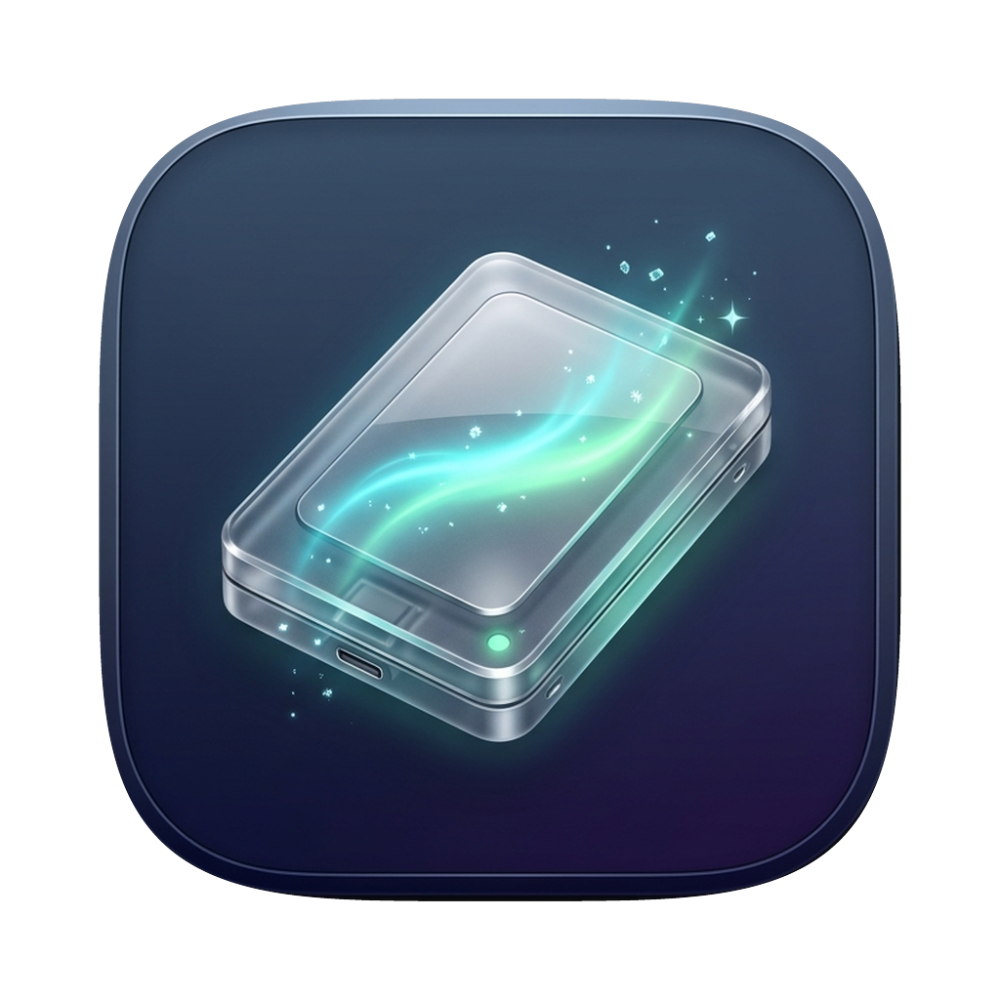
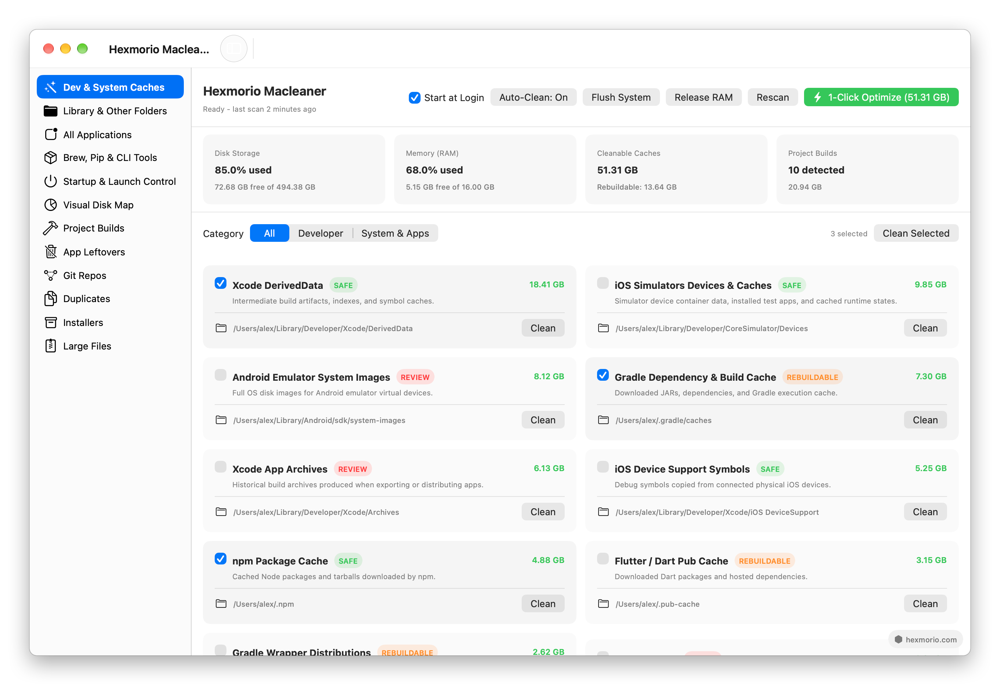
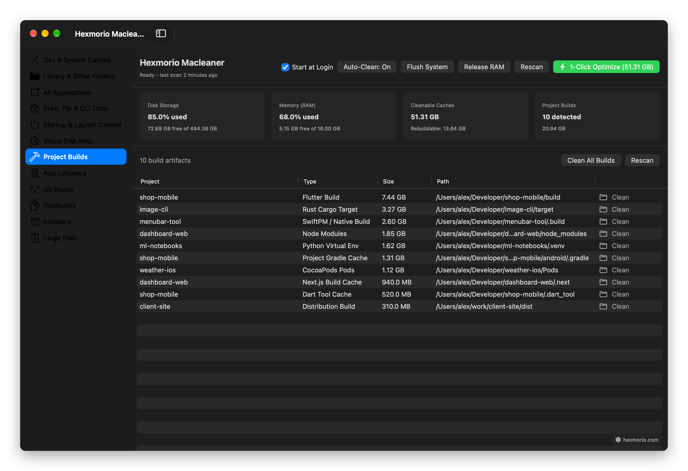
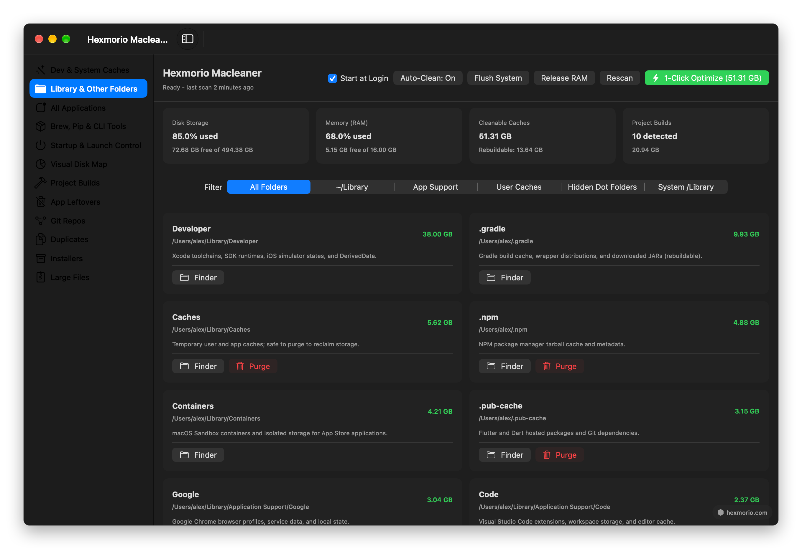
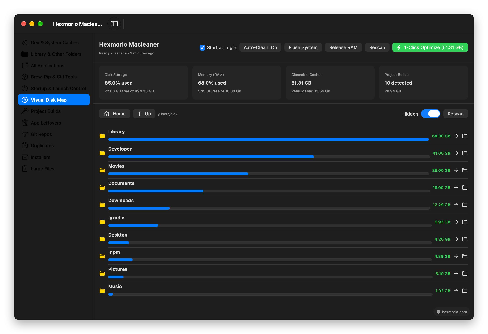
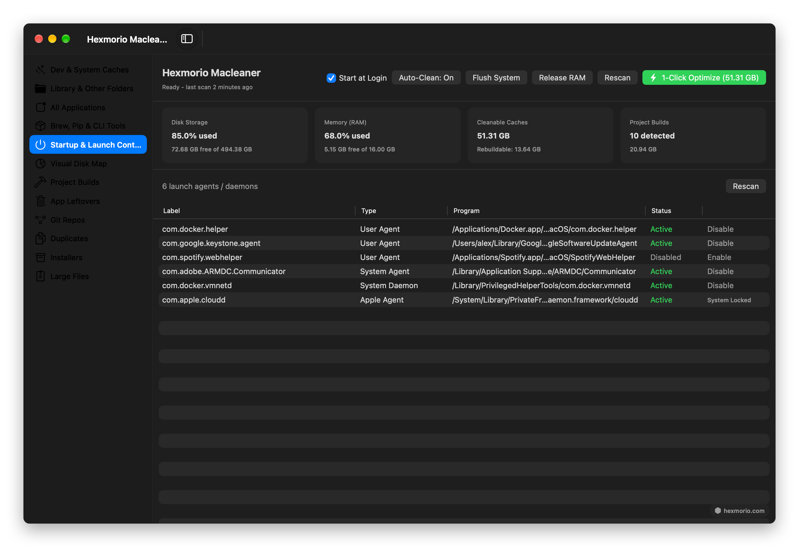
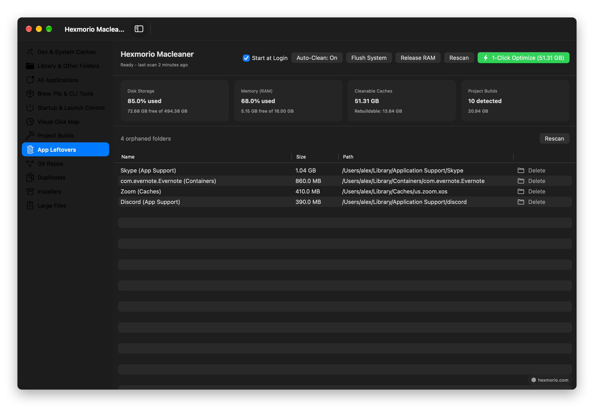
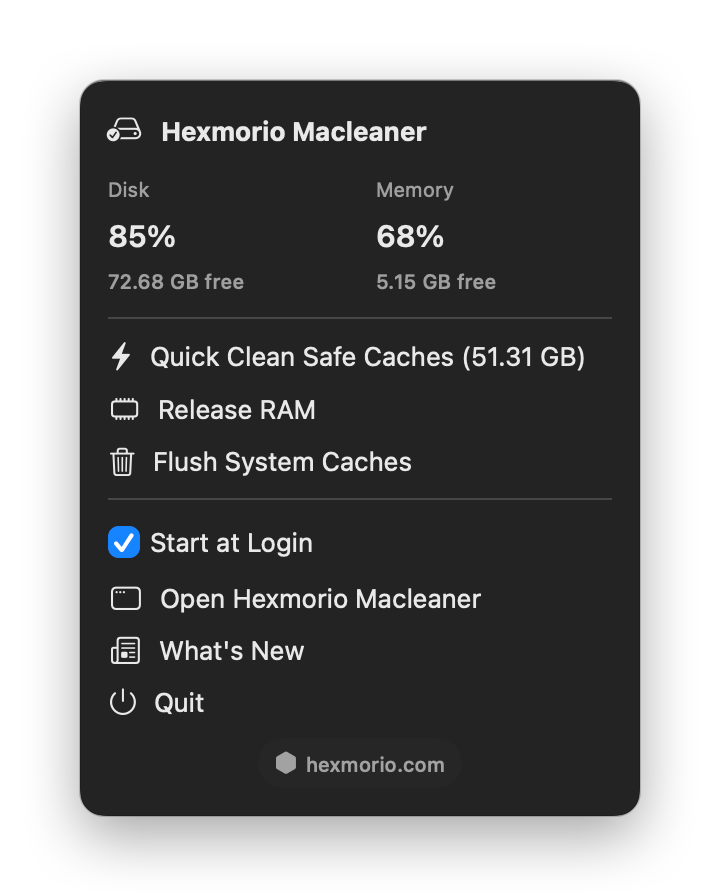

<div align="center">



# Hexmorio Macleaner

**Free, open-source Mac cleaner for developers.**
Reclaim tens of gigabytes from Xcode DerivedData, simulators, Gradle, npm, Flutter and CocoaPods caches, plus `node_modules`, `build` and `Pods` folders in every project. Native SwiftUI, menu bar app, no subscription.

[](https://github.com/hayatkhan67/Hexmorio-Macleaner/releases/latest)
[](#install)
[](#install)
[](StorageOptimizerNative)
[](LICENSE)

[**Install**](#install) · [Screenshots](#screenshots) · [What it cleans](#what-it-cleans) · [Safety](#is-it-safe) · [FAQ](#faq) · [Changelog](CHANGELOG.md)

<picture>
  <source media="(prefers-color-scheme: dark)" srcset="docs/images/optimizer-dark.png">
  
</picture>

</div>

---

## Why Hexmorio Macleaner?

macOS hides most developer clutter under **"System Data"** in Storage settings. Xcode, Android Studio, Flutter, Node and Python leave build output and download caches all over your disk, and a few months of work can fill a 256 GB or 512 GB Mac.

Hexmorio Macleaner finds that space and tells you what each folder is, how big it is, and whether it is safe to delete, before you delete anything.

- 🧹 **One-click cleanup** of caches that are always safe to remove.
- 🔨 **Finds build folders in every project** on your Mac and external drives, not only in `~/projects`.
- 🛡️ **Safety first.** Every item is labelled SAFE, REBUILDABLE or REVIEW, and app data goes to the Trash so you can restore it.
- 🪶 **Light.** Native SwiftUI, about 25–40 MB of RAM while idle, and it lives in the menu bar.
- 🔄 **Updates itself** from signed GitHub releases.

---

## Install

Run this in Terminal to install the latest signed build into `/Applications` (run it again any time to update):

```bash
curl -fsSL https://github.com/hayatkhan67/Hexmorio-Macleaner/releases/latest/download/install.sh | bash
```

Or download the `.dmg` from the [latest release](https://github.com/hayatkhan67/Hexmorio-Macleaner/releases/latest).

**Requirements:** macOS 14 Sonoma or later, Apple Silicon or Intel.

**Recommended:** on first launch, click **Open Settings** in the banner and turn on **Full Disk Access** for Hexmorio Macleaner. Without it, the app still works, but it skips folders macOS protects (Mail, Messages, Safari, app containers) so you never get a stream of permission popups.

---

## Screenshots

| Project build folders | Library & hidden folders |
|---|---|
|  |  |
| **Visual disk map** | **Startup & launch control** |
|  |  |
| **Leftovers from deleted apps** | **Menu bar quick actions** |
|  | <p align="center"></p> |
---

## What it cleans

| Area | Examples | How it is handled |
|---|---|---|
| **Xcode & iOS** | `DerivedData`, `iOS DeviceSupport`, `Archives`, `DocumentationCache`, `CoreSimulator/Devices` | SAFE / REVIEW per item |
| **Android & Gradle** | `~/.gradle/caches`, `wrapper/dists`, emulator system images, AVDs, NDK | REBUILDABLE / REVIEW |
| **Flutter & Dart** | `.pub-cache`, `.dartServer`, project `build/` and `.dart_tool/` | REBUILDABLE |
| **Node & web** | npm and pnpm caches, `node_modules`, `.next`, `.nuxt`, `.turbo`, `.angular`, `.svelte-kit`, `dist` | SAFE / per project |
| **Swift, Rust, Python, C++** | SwiftPM `.build`, Cargo `target`, `.venv`, `__pycache__`, `.pytest_cache`, `CMakeFiles` | per project |
| **Package managers** | Homebrew cache, CocoaPods, pip, TypeScript, node-gyp | SAFE |
| **macOS** | user caches and logs, diagnostic reports, `HTTPStorages`, Trash, `/Library/Caches` | SAFE / REVIEW |
| **Apps** | installed apps by size, leftovers from deleted apps, Homebrew formulas, global npm packages | moved to Trash / uninstalled |
| **Files** | duplicates (full SHA-256 match), installers (`.dmg`, `.pkg`, `.xip`, `.ipa`, `.aab`, ...), large files | moved to Trash |
| **Git** | large `.git` folders, compressed with `git gc --prune=now` | in place |

<details>
<summary><b>All features</b></summary>

- **Dev & System Caches:** 38+ cache locations with live sizes, each labelled **SAFE** (no side effects), **REBUILDABLE** (downloaded again when needed) or **REVIEW** (check first, may need your password).
- **Project Builds:** walks your home folder and external drives up to 7 levels deep and finds 20+ kinds of build and dependency folders, measured natively in parallel.
- **Library & Other Folders:** breaks down `~/Library`, Application Support, `~/Library/Caches`, hidden home folders (`~/.gradle`, `~/.nvm`, `~/.pub-cache`, ...) and `/Library`, the folders behind "System Data".
- **App Leftovers:** matches Application Support, Caches, Containers and Saved Application State against your installed apps by name and bundle ID.
- **All Applications** and **Brew, Pip & CLI Tools:** sizes for every app, Homebrew formula and global package, with uninstall buttons.
- **Startup & Launch Control:** turn user and system launch agents and daemons on or off.
- **Visual Disk Map:** drill into any folder with proportional size bars.
- **Duplicates:** byte-identical files (full SHA-256) in Downloads, Desktop and Documents, keeping the newest copy.
- **Installers & Large Files:** recursive scans of your home folder and external drives.
- **Release RAM** and **Flush System Caches** without an admin password.
- **Background monitor:** checks free space every 30 seconds, rescans when it changes a lot, and warns once when the disk is 90% full.
- **Weekly Auto-Clean** of SAFE caches, **Start at Login**, **menu bar mode** (no Dock icon when the window is closed) and **What's New** after each update.

</details>

---

## Is it safe?

Every delete goes through one safety check in [`SafeDelete.swift`](StorageOptimizerNative/Sources/StorageOptimizer/SafeDelete.swift):

1. **Protected paths.** It never deletes `/`, `/System`, `/Library`, `/Applications`, your home folder, `~/Library`, `~/Desktop`, `~/Documents`, `~/Downloads` or `~/Pictures` themselves.
2. **Safety tiers.** 1-Click Optimize and weekly Auto-Clean only touch **SAFE** caches and never ask for a password.
3. **Trash, not gone.** Large files, installers, duplicates, apps, Application Support folders and unknown hidden folders go to the Trash. Folders with keys or settings (`~/.ssh`, `~/.kube`, `~/.docker`, `~/.android`, ...) cannot be purged at all.
4. **Real build folders only.** `build`, `.build`, `dist` and `target` are only listed when the folder above them belongs to a tool that creates them and git tracks no files inside them.
5. **Signed updates.** The updater checks the code signature of every download before installing it.

---

## FAQ

<details>
<summary><b>Is Hexmorio Macleaner free?</b></summary>

Yes. It is free and open source under the MIT license, with no subscription, account or telemetry.
</details>

<details>
<summary><b>Is it safe to delete Xcode DerivedData?</b></summary>

Yes. DerivedData only holds build output and indexes. Xcode rebuilds it on the next build, which takes a bit longer the first time. Hexmorio Macleaner marks it **SAFE**.
</details>

<details>
<summary><b>Will deleting node_modules or build folders break my project?</b></summary>

No. They are generated by `npm install`, `flutter build`, `cargo build` and similar commands and come back when you run them again. The app only lists folders it can confirm are generated.
</details>

<details>
<summary><b>Why is "System Data" so large on my Mac?</b></summary>

Storage settings put caches, logs, simulators, Application Support and hidden developer folders under "System Data". The **Library & Other Folders** and **Dev & System Caches** tabs show exactly which folders make up that number.
</details>

<details>
<summary><b>Does it need Full Disk Access?</b></summary>

It is optional but recommended. With it, the app can measure and clean every cache without macOS asking about each folder. Without it, protected folders are skipped.
</details>

<details>
<summary><b>Does it collect any data?</b></summary>

No. Everything runs locally. The only network request is the daily update check against GitHub Releases.
</details>

---

## Build from source

Requires macOS 14+ and Xcode or the Swift 5.10+ command-line tools.

```bash
cd StorageOptimizerNative
./build.sh               # or ./build.sh --universal for Apple Silicon + Intel
open "dist/Hexmorio Macleaner.app"
```

`build.sh` signs the app with your *Developer ID Application* or *Apple Development* certificate (override with `SIGN_IDENTITY`). A stable certificate keeps Full Disk Access across rebuilds.

To publish a release: `./release.sh 1.1.0 "notes"` sets the version, builds a universal signed app, and publishes the `.zip`, `.dmg` and `install.sh` to GitHub Releases with `gh`.

### Python + browser version

A zero-build version for any Mac with Python 3:

```bash
python3 server.py   # then open http://127.0.0.1:4820
```

It binds to `127.0.0.1` only and rejects cross-origin requests.

---

## Contributing

Bug reports and pull requests are welcome. Please open an [issue](https://github.com/hayatkhan67/Hexmorio-Macleaner/issues) first for larger changes. See the [changelog](CHANGELOG.md) for recent work.

## License

MIT, see [LICENSE](LICENSE). Made by [Hexmorio](http://hexmorio.com/).
